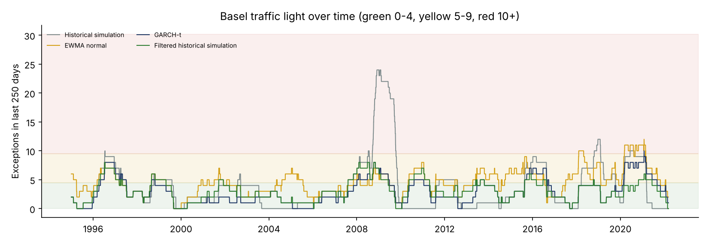
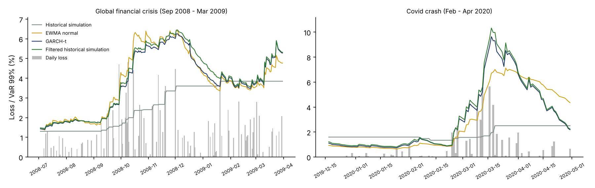

# Market Risk: VaR and Expected Shortfall with Regulatory Backtesting

A from-scratch Python market risk engine applied to 28 years of real daily data (1994-2022, including the 2008 crisis and the Covid crash):

1. **Portfolio**: 60% equities (20 large US stocks, equal-weighted) and 40% constant-maturity 10-year US Treasury, rebalanced daily. Bond returns come from exact repricing of a par bond on the daily Treasury yields.
2. **Four models** forecast one-day 99% VaR and 97.5% Expected Shortfall every day, using only past data:
   - historical simulation;
   - EWMA normal (RiskMetrics);
   - GARCH(1,1) with Student-t innovations, fitted by maximum likelihood from scratch;
   - filtered historical simulation.
3. **Backtesting** on 7,043 days:
   - the Kupiec and Christoffersen tests;
   - the Basel traffic light;
   - two Expected Shortfall backtests (Acerbi-Szekely Z2 and McNeil-Frey).
4. **Stressed Expected Shortfall** on the 2008-2009 window, the idea behind Basel 2.5 and FRTB.

## Key results

| Model | Exceptions (expected 70) | Kupiec p | Christoffersen (cond. coverage) p | Time in red zone | ES: Acerbi-Szekely Z2 | ES: McNeil-Frey p | Verdict |
|---|---|---|---|---|---|---|---|
| Historical simulation | 105 | 0.0001 | < 0.0001 | 5.8% | -0.29 | 0.009 | ❌ Fails |
| EWMA normal | 130 | < 0.0001 | < 0.0001 | 4.2% | -0.42 | < 0.001 | ❌ Fails |
| **GARCH-t** | **81** | **0.22** | **0.10** | **0.01%** | **-0.10** | **0.11** | ✅ **Passes all tests** |
| Filtered historical simulation | 85 | 0.09 | 0.02 | 0.0% | -0.11 | 0.19 | ⚠️ Fails independence at 5% |



**What the table says:**

- **Historical simulation reacts too slowly.** A 500-day window barely moves when volatility explodes. In the 2008 crisis, it had **19 exceptions in 144 days** against 1.4 expected, and it spent most of 2009 deep in the red zone (up to 24 exceptions in 250 days).
- **The normal distribution underestimates the tails.** EWMA adapts to volatility quickly, but with 130 exceptions instead of 70, normal tails are simply too thin for daily returns.
- **GARCH-t combines both fixes**: volatility that reacts within days, and fat tails. It is the only model that passes coverage, independence and both ES tests; it touched the red-zone threshold only once (10 exceptions in a 250-day window). Filtered historical simulation is close behind: its coverage is fine, but its exceptions cluster slightly.



The zoom shows the problem with historical simulation: its VaR (grey) climbs in steps, weeks after the losses, while the volatility-scaled models adjust within days.

## Validation

| Check | Result |
|---|---|
| GARCH-t maximum likelihood vs the `arch` library (full sample) | alpha 0.07684 vs 0.07688, beta 0.91587 vs 0.91584, nu 8.442 vs 8.441; log-likelihood 29,929.85 vs 29,929.81 |
| GARCH-t on 20,000 simulated returns with known parameters | alpha 0.084 (true 0.08), beta 0.898 (0.90), nu 5.6 (6) |
| Basel traffic-light cut-offs (250 days, 99%) | P(X <= 4) = 89.22%, P(X <= 9) = 99.97%, matching the Basel (1996) table |
| Bond pricing | a par bond prices at 100.0000; with an unchanged yield, the one-day return equals the carry |
| No look-ahead (`tests/test_no_lookahead.py`) | changing returns from day k leaves every forecast made up to day k unchanged, for all four models |

**Two findings from the validation work:**

- **A double-counted coupon.** The first version of the bond return added the accrued coupon on top of the discounted price. That price (the full, or dirty, price) already includes the accrual, so the coupon was counted twice. It was caught by checking that, with an unchanged yield, the one-day return equals the carry.
- **The ES tests differ in power.** With the suggested critical value of -0.70 (Acerbi & Szekely, 2014), the Z2 test rejects none of the four models, while McNeil-Frey rejects historical simulation and EWMA. Critical values of Z2 depend on the model (Spring, 2021), so a simulation-based critical value would be the stricter choice.

## Stressed Expected Shortfall

Historical ES on the stress window (September 2008 to August 2009) is **4.29%** of the portfolio, against **1.04%** over the last 250 days, a ratio of **4.1**. This is why Basel 2.5 introduced stressed VaR, and why FRTB calibrates ES to a stress period: risk measured in calm markets says little about a crisis.

## Data and portfolio

| Series | Annual return | Annual volatility | Worst day | Correlation with equities |
|---|---|---|---|---|
| Equities (20 stocks, equal-weighted) | 19.0% | 19.0% | -10.8% | 1.00 |
| 10-year Treasury | 5.9% | 7.3% | -2.8% | -0.21 |
| 60/40 portfolio | 13.7% | 11.1% | -5.7% | 0.97 |

- **Survivorship bias.** The 20 stocks are today's large companies (Apple, Microsoft, JPMorgan and others), selected with hindsight, so the equity return is inflated. That does not affect the risk backtests, which test the models' forecasts against realised returns, but the return figures should not be read as an investment result.
- **Diversification.** Bonds were negatively correlated with equities over the period, which reduces portfolio risk.

## Method notes

- **Historical simulation** uses a 500-day window.
- **EWMA** uses lambda = 0.94.
- **GARCH-t** is refitted every 21 days on the trailing 1,000 days, and the variance is updated daily. VaR and ES use the quantile and ES of a unit-variance Student-t.
- **Filtered historical simulation** takes the empirical quantiles of the last 500 standardised GARCH residuals, scaled by the current volatility.
- **Kupiec:** likelihood ratio on the exception rate. **Christoffersen:** first-order Markov test of independence, combined with Kupiec for conditional coverage. **Traffic light:** rolling 250-day exception counts.
- **ES backtests:** Acerbi-Szekely Z2 uses exceedances of the 97.5% VaR. McNeil-Frey tests whether the volatility-scaled excess losses beyond ES have mean zero, with a one-sided bootstrap p-value.

## Repository structure

```
├── run_study.py         # portfolio, GARCH validation, rolling forecasts, backtests, stress, charts
├── data/
│   ├── sp500_20_stocks.csv.gz   # 20 US stocks, daily prices 1990-2022 (skfolio datasets)
│   └── ust_raw.csv              # US Treasury par yields 1990-2022
├── src/
│   ├── models.py        # bond returns, GARCH-t maximum likelihood, four VaR/ES models
│   └── backtest.py      # Kupiec, Christoffersen, traffic light, Acerbi-Szekely, McNeil-Frey
├── tests/
│   └── test_no_lookahead.py
└── results/
    ├── figures/
    ├── tables/
    └── run_log.txt
```

## How to run

```bash
pip install -r requirements.txt
python run_study.py
```

The full run takes about a minute.

## Limitations and next steps

- **Horizon.** One-day horizon; FRTB uses 10-day ES with liquidity horizons by risk factor.
- **Portfolio.** Linear exposures; options would need full revaluation or delta-gamma approximations.
- **Correlations.** Portfolio-level volatility models; a multivariate model (DCC-GARCH) would capture time-varying correlations between equities and bonds.
- **ES critical values.** Simulation-based critical values for the ES tests, and comparative backtesting with scoring functions (Fissler-Ziegel).

## References

- Kupiec, P. (1995). Techniques for verifying the accuracy of risk measurement models. *Journal of Derivatives*.
- Christoffersen, P. (1998). Evaluating interval forecasts. *International Economic Review*.
- Basel Committee on Banking Supervision (1996). *Supervisory framework for the use of backtesting in conjunction with the internal models approach*.
- McNeil, A. and Frey, R. (2000). Estimation of tail-related risk measures for heteroscedastic financial time series. *Journal of Empirical Finance*.
- Acerbi, C. and Szekely, B. (2014). Backtesting expected shortfall. *Risk*.

---

**Author:** Yassine El Bakali, MSc in Actuarial Science (ULB) · yelbakali@yahoo.be
